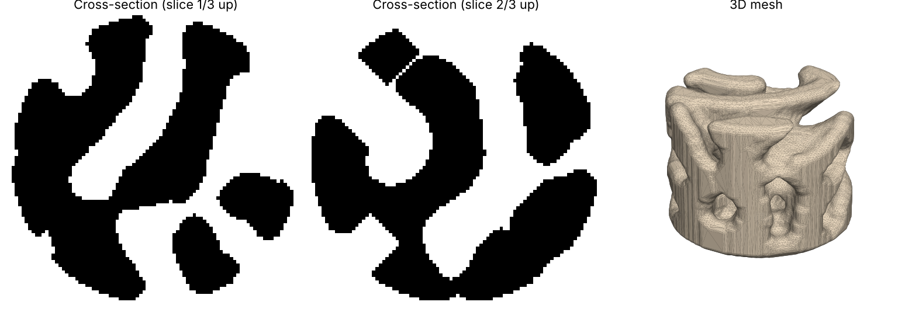

# Reaction-Diffusion Coral Skeleton

[](https://github.com/matinhafiyyan/Coral-Reef-Skeleton-Reaction-Diffusion-Design-Methodology/actions/workflows/tests.yml)

Python scripts that grow a 3D-printable coral settlement structure from a Gray-Scott reaction-diffusion simulation, plus a base plate with threaded M3 studs to mount the printed corals on.

The lattice is inspired by the meandering valleys of *Platygyra* (brain coral). It is designed for binder-jet printing in calcium carbonate, and can be prototyped in PLA on an FDM printer without supports.



## What is in this repository

| Path                  | Contents                                                                                |
| --------------------- | --------------------------------------------------------------------------------------- |
| `coral_reef.py`       | Generates the coral structure: a porous cylinder with an M3 threaded hole in the bottom |
| `base_plate_studs.py` | Generates a flat plate with threaded M3 studs; each coral screws onto one stud          |
| `code_walkthrough.md` | Plain-language explanation of how both scripts work and why                             |
| `examples/`           | Reference outputs to check that your run reproduces the published result                |
| `tests/`              | Automated checks that every model is printable and reproducible                         |
| `CHANGELOG.md`        | How the design developed, version by version                                            |
| `requirements.txt`    | The exact library versions the results were made with                                   |

## Why a script?

The structure is generated by code rather than modelled by hand so that the method can be repeated and tested. Every model comes from a short list of settings, the same settings always give the same model, and each model is saved with a record of its settings, measurements and software versions. See [code_walkthrough.md](code_walkthrough.md) for the full reasoning.

## Quick start

```bash
# 1. Create an environment (Anaconda Prompt on Windows, Terminal on macOS)
conda create -n coral python=3.13 -y
conda activate coral
python -m pip install -r requirements.txt

# 2. Generate a coral (a few minutes)
python coral_reef.py

# 3. Generate the base plate (under a minute)
python base_plate_studs.py
```

Each script writes three files to the folder it runs in:

| File            | What it is                                                                    |
| --------------- | ----------------------------------------------------------------------------- |
| `*.stl`         | The printable model, in millimetres. Import at 100% scale.                    |
| `*_params.json` | Every setting used, the measurements of the result, and the software versions |
| `*_preview.png` | A quick picture to check the result before slicing                            |

## Making your own variants

All settings are at the top of each script, in the block marked `SETTINGS - change these`. Most people only need these:

| Setting (`coral_reef.py`)        | What it does                                                                                |
| -------------------------------- | ------------------------------------------------------------------------------------------- |
| `SEED`                           | Picks a different random starting point: a new pattern with the same statistics             |
| `DIAMETER_MM`, `HEIGHT_MM`       | Outer size. `HEIGHT_MM` already includes the base                                           |
| `VOXELS_ACROSS`                  | Pattern scale. Change it in proportion to `DIAMETER_MM` to keep channel sizes the same      |
| `SOLID_FRACTION`                 | How much of the part is solid. Lower = more porous                                          |
| `SKIN_STRENGTH`                  | 0 = open lattice on the surface; higher = more closed, brain-coral-like surface             |
| `MIN_STRUT_MM`, `MIN_CHANNEL_MM` | Thinnest wall and narrowest channel allowed. Set from your printer's limits                 |
| `MAX_OVERHANG_DEG`               | 45 for support-free FDM printing; `None` for binder jetting, where powder supports the part |

| Setting (`base_plate_studs.py`) | What it does                                                              |
| ------------------------------- | ------------------------------------------------------------------------- |
| `PLATE_X_MM`, `PLATE_Y_MM`      | Plate size                                                                |
| `STUD_COLUMNS`, `STUD_ROWS`     | Number of studs                                                           |
| `MODEL_FOOTPRINT_MM`            | Width of one coral. **Must be at least `DIAMETER_MM` in `coral_reef.py`** |

The thread settings (`THREAD_PITCH_MM` and the minor and major diameters) must match between the two scripts, or the corals will not screw on. The tests check this for you.

## Reproducing a result

A design is fully defined by its `_params.json`. To rebuild one exactly:

1. Check out the version of the code the design was made with (its Git tag or commit).
2. Install the library versions listed under `software` in the JSON (the defaults are in `requirements.txt`).
3. Copy the values from `parameters` in the JSON into the settings block.
4. Run the script. The same `SEED` and settings give the same model.

To check your setup against the published example, see [examples/README.md](examples/README.md).

## Testing

```bash
python -m pip install pytest
pytest                                         # fast checks, about 2 minutes
RUN_SLOW=1 pytest tests/test_reproduce_example.py   # full reproduction of the example
```

The fast checks run the whole pipeline on a small grid and confirm that each model is a single watertight piece of the requested size, that its JSON records every setting, that the same settings give a byte-identical file, and that the coral and base plate threads match. They also run automatically on GitHub for every change.

## How it works

See [code_walkthrough.md](code_walkthrough.md) for a plain-language explanation of every part of both scripts.

In short, `coral_reef.py`:

1. Simulates two virtual chemicals reacting and spreading in a 3D grid (Gray-Scott model).
2. Turns high-concentration regions into solid and the rest into open channels.
3. Cuts the result to a cylinder and adds a solid base.
4. Fixes anything unprintable: walls too thin, channels too narrow, overhangs, loose bits, sealed pockets.
5. Measures wall and channel sizes.
6. Converts the voxels to a smooth mesh, cuts an M3 thread into the bottom and saves an STL.

## Limitations

This is a proof of concept.

- The structures have not yet been tested in seawater, and there is no data yet on coral larvae settling on them.
- The water flow through the channels has not been simulated or measured.
- The resemblance to *Platygyra* is visual. Channel sizes are set for printability, not matched to a coral species or to published larval settlement preferences.
- The M3 thread has a rounded profile made to fit the printed studs, not the standard metric shape. Check the fit before using commercial screws.
- Exact byte-for-byte reproduction is confirmed on the same platform and library versions. Other systems may give very slightly different meshes; compare the JSON measurements instead.

## Issues and contributions

Found a problem or have a question? Open an issue on this repository and include your `_params.json` file and the error message. Suggestions and pull requests are welcome; please run `pytest` before submitting a change.

## Acknowledgements and references

- Karl Sims, [Reaction-Diffusion Tutorial](https://karlsims.com/rd.html): the reference for the Gray-Scott model used here.
- Gray, P. and Scott, S. K. (1984). Autocatalytic reactions in the isothermal, continuous stirred tank reactor. *Chemical Engineering Science*, 39(6), 1087-1097.
- Pearson, J. E. (1993). Complex patterns in a simple system. *Science*, 261(5118), 189-192.
- Inspired by Alex Schofield's Coral Carbonate project.

## Use of AI tools

Parts of the code and documentation in this repository were written with help from an AI assistant (Claude, by Anthropic).

## Authors

- Matin Hafiyyan, Temasek Polytechnic
- Angus Tan, Temasek Polytechnic
- Henry Ng, Temasek Polytechnic
- Dr Zhang Guangyu, Research Scientist, Digital Fabrication and Additive Manufacturing Centre, Temasek Polytechnic

## Licence

MIT. See [LICENSE](LICENSE).
