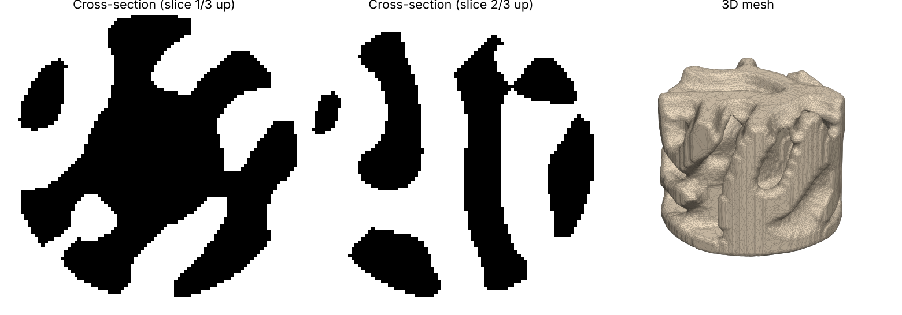
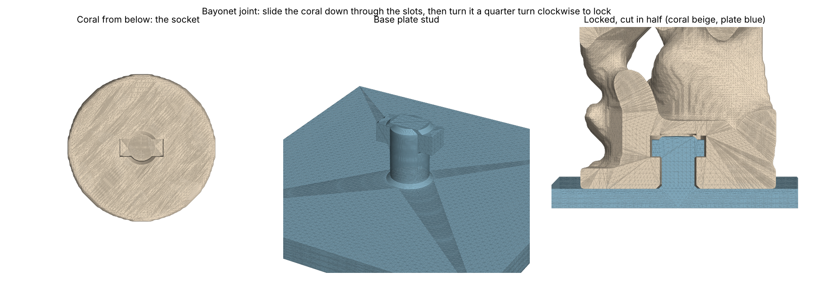

# Reaction-Diffusion Coral Skeleton

[](https://github.com/matinhafiyyan/Coral-Reef-Skeleton-Reaction-Diffusion-Design-Methodology/actions/workflows/tests.yml)

Python scripts that grow a 3D-printable coral settlement structure from a Gray-Scott reaction-diffusion simulation, plus a base plate with bayonet studs to mount the printed corals on.

The lattice is inspired by the meandering valleys of *Platygyra* (brain coral). It is designed for binder-jet printing in calcium carbonate, and can be prototyped in PLA on an FDM printer without supports.

Version 2 replaces the screw thread with a quarter-turn bayonet joint. Push the coral onto a stud, turn it 90 degrees and it locks: no screws, no adhesive, nothing that has to survive the sintering furnace except the printed parts themselves.





## What is in this repository

| Path                   | Contents                                                                          |
| ---------------------- | --------------------------------------------------------------------------------- |
| `coral_reef.py`        | Generates the coral structure: a porous cylinder with a bayonet socket underneath |
| `base_plate_studs.py`  | Generates a flat plate with bayonet studs; each coral locks onto one stud         |
| `tools/joint_fit.py`   | Checks that a coral and a plate fit, turn and lock, before you print them         |
| `tools/joint_views.py` | Draws the joint (socket, stud, half-section) and exports a 3D assembly            |
| `code_walkthrough.md`  | Plain-language explanation of how the scripts work and why                        |
| `examples/`            | Reference outputs to check that your run reproduces the published result          |
| `tests/`               | Automated checks that every model is printable, reproducible and fits             |
| `CHANGELOG.md`         | How the design developed, version by version                                      |
| `requirements.txt`     | The exact library versions the results were made with                             |

## Why a script?

The structure is generated by code rather than modelled by hand so that the method can be repeated and tested. Every model comes from a short list of settings, the same settings always give the same model, and each model is saved with a record of its settings, measurements and software versions. See [code_walkthrough.md](code_walkthrough.md) for the full reasoning.

## Quick start

```bash
# 1. Create an environment (Anaconda Prompt on Windows, Terminal on macOS)
conda create -n coral python=3.13 -y
conda activate coral
python -m pip install -r requirements.txt

# 2. Generate a coral (a few minutes)
python coral_reef.py

# 3. Generate the base plate (under a minute)
python base_plate_studs.py

# 4. Optional: check that they fit and lock
python tools/joint_fit.py coral_cylinder_seed23_bayonet.stl coral_cylinder_seed23_bayonet_params.json baseplate_90x90x3_4studs_bayonet.stl baseplate_90x90x3_4studs_bayonet_params.json
```

Each script writes three files to the folder it runs in:

| File            | What it is                                                                    |
| --------------- | ----------------------------------------------------------------------------- |
| `*.stl`         | The printable model, in millimetres. Import at 100% scale.                    |
| `*_params.json` | Every setting used, the measurements of the result, and the software versions |
| `*_preview.png` | A quick picture to check the result before slicing                            |

The base plate script also writes a `.3mf` copy when `EXPORT_3MF = True`.

## The bayonet joint



Each stud is a 5 mm round shaft, 8 mm tall, with two small lugs near the top (8 mm across, 3 mm wide, 2.5 mm tall). The coral has a matching socket in a solid boss under its base: a round bore, two vertical slots for the lugs, and a pocket at the top that lets the lugs turn.

**To lock:** line the slots up with the lugs, push the coral down until it sits flat on the plate, then turn it 90 degrees clockwise (seen from above). **To remove:** turn it back 90 degrees and lift.

How it holds:

- The lugs sit under a shelf in the socket, so the coral cannot be pulled straight off once turned.
- The shelf is ramped. It starts 0.3 mm clear of the lugs, so the coral turns freely, and closes to 0.05 mm at the locked position, so the coral is pulled down snug against the plate as you turn it.
- The pocket ends at 90 degrees, so the coral cannot be over-turned past the lock.
- The stud has a 0.5 mm fillet where it meets the plate and on top of each lug, to make the most likely break points stronger.

For the reference example, `tools/joint_fit.py` measures the vertical play as 0.24 mm at 30 degrees, 0.16 mm at 60 degrees and 0.07 mm when locked.

**Why not a screw or glue?** Binder-jet parts are printed as fragile "green" parts and then fired at high temperature. Metal or nylon screws would not survive the furnace with the part, and adhesive would add a second material to a structure meant to be pure calcium carbonate. A printed bayonet is part of the coral and the plate themselves, and a quarter turn is easier to do with gloves on, or underwater, than several turns of a thread.

## Making your own variants

All settings are at the top of each script, in the block marked `SETTINGS - change these`. Most people only need these:

| Setting (`coral_reef.py`)        | What it does                                                                                |
| -------------------------------- | ------------------------------------------------------------------------------------------- |
| `SEED`                           | Picks a different random starting point: a new pattern with the same statistics             |
| `DIAMETER_MM`, `HEIGHT_MM`       | Outer size. `HEIGHT_MM` already includes the base                                           |
| `VOXELS_ACROSS`                  | Pattern scale. Change it in proportion to `DIAMETER_MM` to keep channel sizes the same      |
| `SOLID_FRACTION`                 | How much of the part is solid. Lower = more porous                                          |
| `SKIN_STRENGTH`                  | 0 = open lattice on the surface; higher = more closed, brain-coral-like surface             |
| `MIN_STRUT_MM`, `MIN_CHANNEL_MM` | Thinnest wall and narrowest channel allowed. Set from your printer's limits                 |
| `MAX_OVERHANG_DEG`               | 45 for support-free FDM printing; `None` for binder jetting, where powder supports the part |
| `ADD_JOINT`                      | `False` gives a coral with a plain flat base and no socket                                  |

| Setting (`base_plate_studs.py`) | What it does                                                              |
| ------------------------------- | ------------------------------------------------------------------------- |
| `PLATE_X_MM`, `PLATE_Y_MM`      | Plate size                                                                |
| `STUD_COLUMNS`, `STUD_ROWS`     | Number of studs                                                           |
| `MODEL_FOOTPRINT_MM`            | Width of one coral. **Must be at least `DIAMETER_MM` in `coral_reef.py`** |

Joint settings, in both scripts:

| Setting                      | Default | What it does                                                      |
| ---------------------------- | ------- | ----------------------------------------------------------------- |
| `STUD_DIA_MM`                | 5.0     | Diameter of the round stud shaft                                  |
| `STUD_HEIGHT_MM`             | 8.0     | Height of the stud above the plate                                |
| `LUG_SPAN_MM`                | 8.0     | Width across both lugs, tip to tip                                |
| `LUG_WIDTH_MM`               | 3.0     | Width of each lug                                                 |
| `LUG_HEIGHT_MM`              | 2.5     | Height of each lug                                                |
| `LUG_TOP_BELOW_TIP_MM`       | 0.5     | Gap from the top of the lugs to the top of the stud               |
| `JOINT_CLEARANCE_MM`         | 0.3     | Gap on every side between stud and socket. Raise it if parts bind |
| `TWIST_DEG` (coral only)     | 90      | How far the coral turns to lock                                   |
| `LOCK_PLAY_MM` (coral only)  | 0.05    | Gap left above the lugs once locked. Smaller = tighter            |
| `JOINT_WALL_MM` (coral only) | 3.0     | Solid wall around the socket                                      |

The shared joint settings must match between the two scripts, or the corals will not fit. The tests check this for you. If your printer makes parts slightly oversize, increase `JOINT_CLEARANCE_MM` in both scripts.

## Reproducing a result

A design is fully defined by its `_params.json`. To rebuild one exactly:

1. Check out the version of the code the design was made with (its Git tag or commit).
2. Install the library versions listed under `software` in the JSON (the defaults are in `requirements.txt`).
3. Copy the values from `parameters` in the JSON into the settings block.
4. Run the script. The same `SEED` and settings give the same model.

To check your setup against the published example, see [examples/README.md](examples/README.md).

## Testing

```bash
python -m pip install pytest
pytest                                              # fast checks, a few minutes
RUN_SLOW=1 pytest tests/test_reproduce_example.py   # full reproduction of the example
```

On Windows (Anaconda Prompt), run `set RUN_SLOW=1` first, then `pytest tests/test_reproduce_example.py`.

The fast checks run the whole pipeline on a small grid and confirm that each model is a single watertight piece of the requested size, that its JSON records every setting, that the same settings give a byte-identical file, and that the coral and base plate joint settings match. A joint-fit test then puts a small coral on a stud and checks that it slides on, turns, cannot be pulled off or over-turned when locked, tightens as it turns, and lifts off again when turned back. The checks run automatically on GitHub for every change.

## How it works

See [code_walkthrough.md](code_walkthrough.md) for a plain-language explanation of every part of the scripts.

In short, `coral_reef.py`:

1. Simulates two virtual chemicals reacting and spreading in a 3D grid (Gray-Scott model).
2. Turns high-concentration regions into solid and the rest into open channels.
3. Cuts the result to a cylinder and adds a solid base and a solid boss for the joint.
4. Fixes anything unprintable: walls too thin, channels too narrow, overhangs, loose bits, sealed pockets.
5. Measures wall and channel sizes.
6. Converts the voxels to a smooth mesh, cuts the bayonet socket into the bottom and saves an STL.

## Limitations

This is a proof of concept.

- The structures have not yet been tested in seawater, and there is no data yet on coral larvae settling on them.
- The water flow through the channels has not been simulated or measured.
- The resemblance to *Platygyra* is visual. Channel sizes are set for printability, not matched to a coral species or to published larval settlement preferences.
- The joint has been checked in software (fit, turn, lock and pull-out) and not yet on printed parts. The lugs are the weakest feature: their strength in green and sintered calcium carbonate, and whether they sag during sintering, are untested.
- Calcium carbonate starts to break down into lime at roughly 600 to 800 degrees C. The sintering schedule has to be chosen with this in mind, and it may change the final size of the parts, and so the fit of the joint.
- There is no catch against turning back: a locked coral is held by the snug ramp, not by a click. Strong surge or currents could, in principle, turn a coral loose.
- Exact byte-for-byte reproduction is confirmed on the same platform and library versions. Other systems may give very slightly different meshes; compare the JSON measurements instead.

## Issues and contributions

Found a problem or have a question? Open an issue on this repository and include your `_params.json` file and the error message. Suggestions and pull requests are welcome; please run `pytest` before submitting a change.

## Acknowledgements and references

- Karl Sims, [Reaction-Diffusion Tutorial](https://karlsims.com/rd.html): the reference for the Gray-Scott model used here.
- Gray, P. and Scott, S. K. (1984). Autocatalytic reactions in the isothermal, continuous stirred tank reactor. *Chemical Engineering Science*, 39(6), 1087-1097.
- Pearson, J. E. (1993). Complex patterns in a simple system. *Science*, 261(5118), 189-192.
- Inspired by Alex Schofield's Coral Carbonate project.

## Use of AI tools

Parts of the code and documentation in this repository were written with help from an AI assistant (Claude, by Anthropic).

## Authors

- Matin Hafiyyan, Temasek Polytechnic
- Angus Tan, Temasek Polytechnic
- Henry Ng, Temasek Polytechnic
- Dr Zhang Guangyu, Research Scientist, Digital Fabrication and Additive Manufacturing Centre, Temasek Polytechnic

## Licence

MIT. See [LICENSE](LICENSE).
